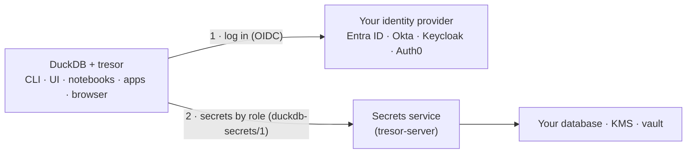

<p align="center">
  <picture>
    <source media="(prefers-color-scheme: dark)" srcset="website/static/img/tresor-icon-dark.svg">
    
  </picture>
</p>

<h1 align="center">tresor</h1>

<p align="center">
  <b>Your company login, your role's secrets — in DuckDB.</b><br>
  <a href="https://hugr-lab.com/tresor">Website</a> ·
  <a href="https://hugr-lab.com/docs/tresor/">Docs</a> ·
  <a href="https://hugr-lab.com/docs/tresor/protocol/">Protocol</a> ·
  <a href="https://github.com/hugr-lab/tresor-server">tresor-server</a>
</p>

<p align="center">
  <a href="https://github.com/hugr-lab/tresor/actions/workflows/ci.yml"></a>
  <a href="https://github.com/hugr-lab/tresor/releases/latest"></a>
  <a href="https://duckdb.org/community_extensions/extensions/tresor"></a>
  <a href="LICENSE"></a>
</p>

DuckDB is a joy on local files. The moment it needs corporate data — a lake on S3, a Postgres, an internal API — the
keys start spreading: into notebook cells, `.env` files, CI variables, one shared key on the server. Every copy is one
more thing to rotate and one more thing to leak, and nobody can say who used what.

**tresor** makes your organization's secrets part of DuckDB's own secret lookup. Log in once with your company
identity — Entra ID, Okta, Keycloak, Auth0 — and every secret your roles may use is simply there:

```sql
INSTALL tresor FROM community;
ATTACH 'tresor:secrets.corp.example' AS corp;   -- log in once (browser or device code)

FROM corp.secrets();                             -- what your roles may use
FROM 's3://lake/sales/*.parquet';                -- the right secret is found by scope, like any secret
ATTACH 'host=crm.corp dbname=sales' AS crm (TYPE postgres, SECRET crm);   -- or by name
```

No key on the laptop, no `.env`, nothing to rotate by hand.

## How it works



1. **ATTACH logs you in** directly with your identity provider, once in the browser or with a device code. The login
   is remembered in the OS keychain, so every DuckDB process you run attaches with no second sign-in.
2. **The service answers with the secrets your roles may use.** It sends only their descriptors (names, types,
   scopes), never their values. DuckDB matches them by scope, the same way it matches its own secrets, or by name.
   Only the secret a query picks is fetched, and only at that moment. It is kept in memory briefly and never written
   to disk.
3. **Administrators manage, roles use.** Administrators create secrets in the service, either from DuckDB
   (`CREATE PERSISTENT SECRET … IN corp`) or in its web console, and grant their use to roles and groups. Revoke a
   grant and the next query no longer sees the secret.

The service can be anything that speaks the open protocol
[`duckdb-secrets/1`](https://hugr-lab.com/docs/tresor/protocol/), a short HTTP spec.
[**tresor-server**](https://github.com/hugr-lab/tresor-server) is the production implementation. It runs as one
container on Azure, Kubernetes, AWS or GCP, with your database, your KMS and your vault.

## What you get

- 🔐 **Secrets by role:** S3, GCS, R2, Azure, Postgres, MySQL, HTTP APIs, Iceberg catalogs, and any other DuckDB
  secret type.
- 🗝️ **Material where it already lives:** referenced in HashiCorp Vault / OpenBao, Azure Key Vault or a cloud secret
  manager, or sealed under your KMS key.
- ⏱️ **Short-lived by design:** a credential can be generated for each user on each read, and cached only until it
  expires.
- 🤖 **Pipelines without passwords:** jobs log in with GitHub Actions OIDC, Kubernetes service accounts, Azure managed
  identities or a private key. dbt-duckdb works through its profile.
- 🌐 **Wherever DuckDB runs:** the CLI, DuckDB UI, Jupyter, DBeaver, and your own Python, Go, Rust or Java
  application. An app that already signed its user in hands tresor that same token (`tresor_web_token`), so there is
  no second login. That includes DuckDB-wasm in the browser, once `@duckdb/duckdb-wasm` ships on DuckDB 2.0.
- 🧾 **Audited:** turn on `tresor_audit_level` and every login, lookup, write and grant becomes an event in DuckDB's
  log. The service keeps its own audit too.

## Try it

You need a secrets service to attach to. The quickest way is **tresor-server in a container** in your own
infrastructure, with a demo identity provider:
[tresor-server — Quickstart](https://hugr-lab.com/docs/tresor-server/quickstart/). Administrators then manage secrets
and grants in its web console: [Using the console](https://hugr-lab.com/docs/tresor-server/console-guide/).

For a trial you need only Docker and a host name that DuckDB can reach. To connect your own identity provider,
prepare:

| You need | Example | Where it comes from |
| --- | --- | --- |
| The issuer URL | `https://login.microsoftonline.com/<tenant>/v2.0` | your IdP's OIDC discovery |
| The service's API audience | the API's client id (Entra) or `duckdb-secrets` (Keycloak) | an app registration (Entra) or client (Keycloak) for the service |
| A public client for people | `duckdb` (redirect to loopback) | a second app registration / client |
| The claim with roles or groups, and the admin role | `roles`, `secrets_admin` | your IdP's token configuration |
| A host name and TLS | `secrets.corp.example` | your DNS and certificates, or a reverse proxy |

Then, in DuckDB 2.0:

```sql
INSTALL tresor FROM community;
ATTACH 'tresor:<your-tresor-server-host>' AS corp;
FROM corp.whoami();
```

Next: [Getting started](https://hugr-lab.com/docs/tresor/getting-started/) ·
[From DuckDB UI, Python and IDEs](https://hugr-lab.com/docs/tresor/clients/) ·
[Pipelines](https://hugr-lab.com/docs/tresor/pipelines/) ·
[In your application](https://hugr-lab.com/docs/tresor/embedding/) ·
[In a web application](https://hugr-lab.com/docs/tresor/web/) ·
[Microsoft Entra ID](https://hugr-lab.com/docs/tresor/entra/) ·
[SQL reference](https://hugr-lab.com/docs/tresor/reference/)

## Platforms

DuckDB's community extensions serve tresor for DuckDB 2.0 on:

- Linux: amd64, arm64
- macOS: arm64
- Windows: amd64 (MSVC and MinGW), arm64
- WebAssembly: `wasm_eh`, `wasm_mvp`, `wasm_threads`

## Building from source

```bash
git clone --recurse-submodules https://github.com/hugr-lab/tresor.git && cd tresor
make vcpkg-setup && GEN=ninja make            # OpenSSL from vcpkg; DuckDB 2.0 from the submodule
build/release/test/unittest 'test/sql/*'
```

The [Development](https://hugr-lab.com/docs/tresor/development/) page covers the tests (against a fake service and
Keycloak), the wasm build and the reference server. Changes are in the [CHANGELOG](CHANGELOG.md).

## License

MIT, see [LICENSE](LICENSE). tresor-server is licensed separately (BUSL 1.1).
