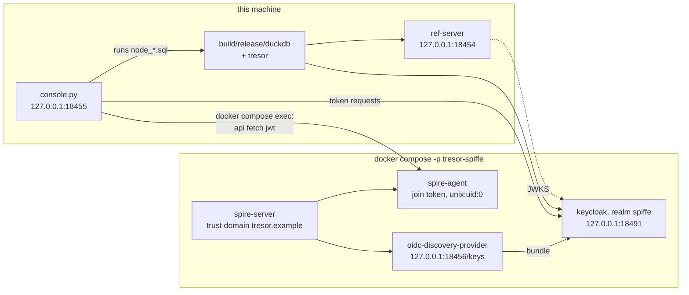

# The SPIFFE spike (specs/046)

Can a node log in to a `duckdb-secrets/1` service with its **JWT-SVID** instead of a stored secret? This spike
answers that question against real pieces: a SPIRE trust domain, a Keycloak that trusts it (identity provider
type `spiffe`, a preview feature), and the reference server. A console page runs each step and shows what
happened. It never shows a token, only the claims.

The route is **Keycloak's own SPIFFE support** wherever it is available (Keycloak 26.4 or later, the `spiffe`
preview feature on, an identity provider of type `spiffe` in the realm). The spike checks that first. Where it is
not available, spec 046's fallback is `jwt-bearer` through an OIDC identity provider.

Spike only: test credentials, plain http on 127.0.0.1, `insecure_bootstrap` for the agent. Never a deployment.



## Run it

You need docker with compose, go, python3 (3.10 or later), and a tresor build: `GEN=ninja make` at the
repository's root, or set `TRESOR_DUCKDB` and `TRESOR_EXTENSION`.

```sh
examples/spiffe-spike/spike.sh up        # SPIRE, Keycloak, two registered workloads, the reference server
examples/spiffe-spike/spike.sh console   # open http://127.0.0.1:18455 and press "Run the spike"
examples/spiffe-spike/spike.sh down      # stop everything, forget the trust domain
```

## What the console runs

| Step | What it shows | What the design wants |
| --- | --- | --- |
| Keycloak's own SPIFFE support is available | the Keycloak version, the `spiffe` feature's state, the realm's identity provider of type `spiffe` (also printed by `spike.sh up`) | available: the route the spike takes |
| SPIRE publishes the trust domain's JWT keys | `/keys` of the OIDC discovery provider: what Keycloak reads as the bundle | keys present |
| The agent issues the node's JWT-SVID | its claims: `sub`, `aud` (the realm), `exp`, whether `iss` and `jti` are present | `iss` absent |
| Keycloak: the SVID as `jwt-spiffe` | the access token's claims (`azp`, `aud` = `duckdb-secrets`, `role:nodes`), or Keycloak's error | ok |
| Keycloak: the SVID as `jwt-bearer` | the same, as tresor sends assertions today | a finding either way |
| The administrator seeds a secret | `spike_lake` (s3) and its grant to `role:nodes`, through the protocol | ok |
| tresor today | `node_today.sql`: `FLOW 'federated'`, `ASSERTION_FILE`; whoami, secrets, the audit's rows | depends on the `jwt-bearer` finding |
| tresor as proposed | `node_proposed.sql`: `ASSERTION_SOURCE 'spiffe'`, `SPIFFE_ID`, `ASSERTION_TYPE` | refused until implemented |
| Another workload's SVID | `spiffe://tresor.example/node/intruder`, presented as `acl-node` | refused (`invalid_client`) |
| An SVID for another audience | the node's SVID with `aud` = `https://elsewhere.example` | refused |

Statuses: **ok**, **expected** (a refusal the design wants), **finding** (an answer spec 046 has to take into
account), **failed** (something is broken, or a check the design relies on did not hold).

## Not verified yet

The pieces were written from SPIRE's and Keycloak's documentation and have not yet been run together. Things that
may need adjusting on the first run, each a finding for spec 046:

- the image tags (`SPIRE_VERSION` 1.13.0, `KEYCLOAK_VERSION` 26.8.1) and Keycloak's feature name (`KC_FEATURES:
  spiffe`);
- the realm's SPIFFE identity-provider keys (`trustDomain`, `bundleEndpoint`) and whether Keycloak accepts SPIRE's
  `/keys` over plain http as the bundle (the realm sets `sslRequired: none`);
- which `client_assertion_type` Keycloak takes, and whether an SVID without `jti` passes its replay check.
