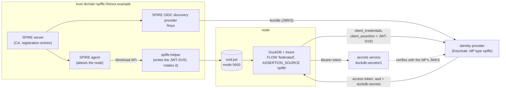
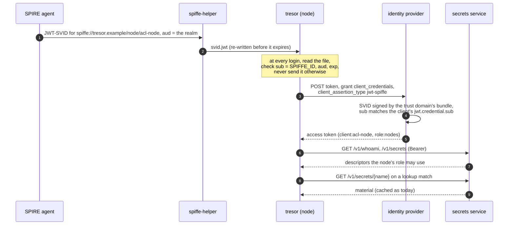
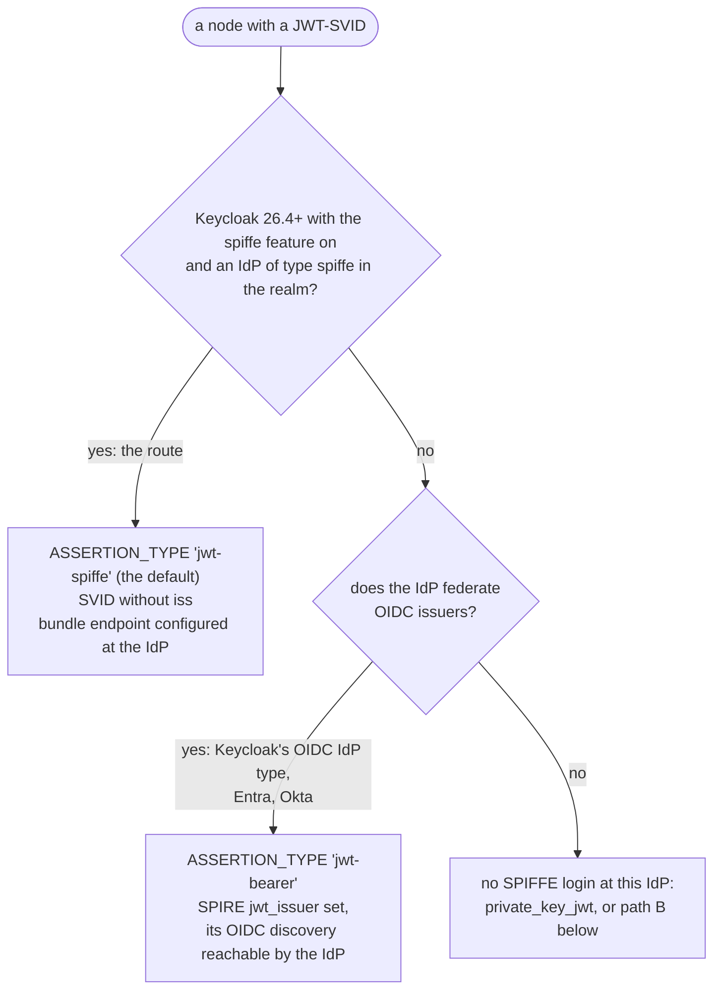
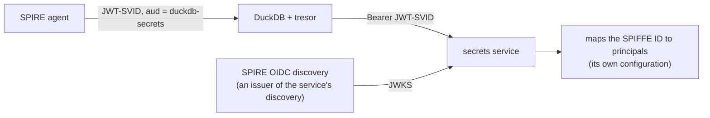

# Spec 046: a node proves itself with SPIFFE - a JWT-SVID as its federated assertion

- **Status**: implemented (2026-10-29, with duckdb-ext-common spec 019) - `ASSERTION_TYPE`, `ASSERTION_SOURCE
  'spiffe'`, `SPIFFE_ID` and the checks before sending; path B and sender-constrained tokens stay research. The
  spike: `examples/spiffe-spike/`
- **Date**: 2026-10-29
- **Author**: hugr lab
- **Asked by**: the owner (2026-10-29): "an identity framework identifying the nodes for authenticated secret
  pull", SPIFFE or something newer, as a configurable option

## Summary

A node (a duckdb-acl server, a pipeline) can already log in without a stored secret: `FLOW 'federated'` sends a
token its platform issued - a Kubernetes service-account token, GitHub Actions' token, an Azure managed
identity - as its client assertion, and the identity provider answers with the service's access token
(specs/013, 015, 027). This spec adds **SPIFFE** as one more such platform: the node's **JWT-SVID**, issued by
SPIRE after it attested the node, is the assertion.

- **Configurable, opt-in**: `ASSERTION_SOURCE 'spiffe'` on the `tresor` secret, with the SVID's file, the SPIFFE
  ID it must carry, and the assertion type the identity provider expects.
- **Keycloak's own SPIFFE support first** (the owner's decision, 2026-10-29): where the identity provider is a
  Keycloak with SPIFFE client authentication available, that is the route - `jwt-spiffe`, the default with source
  `spiffe`. `jwt-bearer` to an IdP that federates SPIRE as an OIDC issuer is the fallback where it is not.
- **No protocol change**: the service still sees an access token from an issuer of its discovery; principals,
  grants, delegation and the audit are unchanged.
- **A cross-repository change**: duckdb-ext-common's OIDC core hard-codes the assertion type
  (`urn:ietf:params:oauth:client-assertion-type:jwt-bearer`, `oidc/src/oidc_core.cpp`); `ClientAuth` gains it,
  specced there as well.

## Problem

- A node logs in with a client secret or a private key on its disk, or with a platform token that exists only on
  that platform (Kubernetes, GitHub, Azure). A fleet across platforms - bare metal, several clusters, VMs - has
  no common identity, so each kind of node is configured its own way and some carry long-lived credentials.
- SPIFFE is the common answer: SPIRE attests a workload by what it is (its node, its pod, its process) and issues
  short-lived SVIDs (minutes), rotated by the agent. Keycloak accepts a JWT-SVID as a client's credential
  ("federated client authentication", identity provider type `spiffe`, a preview feature); Entra, Okta and others
  accept one when SPIRE's OIDC discovery provider is configured as a federated issuer.
- tresor can read an SVID today (`ASSERTION_FILE`, written by `spiffe-helper`), but always sends it as
  `jwt-bearer`. Keycloak's SPIFFE authentication expects its own type (the IETF draft "OAuth SPIFFE Client
  Authentication": `urn:ietf:params:oauth:client-assertion-type:jwt-spiffe`). The spike confirms which one
  Keycloak takes.

## Design

### Where SPIFFE fits



The service never sees the SVID: it keeps one kind of token, one issuer list, and the principals the identity
provider puts into tokens (`client:acl-node`, `role:nodes`). What changes is only how the node proves itself to
the identity provider: by what SPIRE attested, not by a secret it holds.

### The login, step by step



A renewal is a new login: tresor reads the file again, so SPIRE's rotation (SVIDs live minutes) needs nothing
of tresor's own. A refresh token is never involved (a service's login has none, specs/013).

### The option

On the `tresor` secret, `FLOW 'federated'`:

| Option | Value | Default | Meaning |
| --- | --- | --- | --- |
| `ASSERTION_SOURCE` | `'spiffe'` | - | the assertion is a JWT-SVID |
| `ASSERTION_FILE` | a path | required | the file `spiffe-helper` writes (`jwt_svids[].jwt_svid_file_name`); no default from the environment, so the secret names every file a login reads |
| `SPIFFE_ID` | `spiffe://…` | - (recommended) | the SVID's `sub` must be this, or it is never sent |
| `ASSERTION_AUDIENCE` | text | the issuer | the SVID's `aud` must contain it, or it is never sent |
| `ASSERTION_TYPE` | `'jwt-spiffe'`, `'jwt-bearer'` | `jwt-spiffe` with source `spiffe`, else `jwt-bearer` | the `client_assertion_type` sent |

```sql
CREATE SECRET node (TYPE tresor, SCOPE 'tresor:secrets.corp.example', FLOW 'federated',
    ISSUER 'https://login.corp.example/realms/main', CLIENT_ID 'acl-node',
    ASSERTION_SOURCE 'spiffe', ASSERTION_FILE '/run/spiffe/svid.jwt',
    SPIFFE_ID 'spiffe://corp.example/ns/data/sa/acl-node');
ATTACH 'tresor:secrets.corp.example' AS corp (SECRET node, ACT_FOR_SESSIONS true);
```

Which assertion type, by identity provider:



**Keycloak's support, when it is available.** Keycloak has it from 26.4 as a preview feature (`spiffe`, enabled
with `--features=spiffe`; the identity provider type `spiffe` and the client authenticator `federated-jwt`). It is
available when the feature is on and the realm has an identity provider of type `spiffe` for the trust domain;
the spike checks both before anything else (Keycloak's server info and the realm's identity providers). tresor
cannot see it from outside - an IdP's discovery does not advertise it - so the type stays the secret's to name,
defaulting to `jwt-spiffe` with source `spiffe`; a Keycloak without the feature answers `invalid_client`, and the
login's error says to check the feature and the realm's identity provider. Where it is not available:
- a Keycloak can still federate SPIRE as an OIDC identity provider (`federated-jwt` with an IdP of type OpenID
  Connect, SPIRE's `jwt_issuer` set and its OIDC discovery reachable): `ASSERTION_TYPE 'jwt-bearer'`;
- another IdP that federates OIDC issuers (Entra, Okta): the same.

**Checks before sending** (as for a managed identity's token, specs/015: an assertion goes only where it is
meant to go):
- the file holds one JWT (as `ASSERTION_FILE` today);
- `sub` is a SPIFFE ID, and `SPIFFE_ID` when given; a mismatch names both IDs, never the token;
- `aud` contains `ASSERTION_AUDIENCE` (default: the issuer, which is what Keycloak requires); an SVID for another
  audience is never sent;
- `exp` has not passed (so a dead helper reads as "the SVID in … expired at …", not as the IdP's `invalid_client`).

**What does not change:** `whoami.login` stays `federated`, and so does the audit's `login` (no `detail` for the
source: a login's detail is not plumbed to where the credential is chosen); discovery's
`service_flows` already lists `federated`; the keychain is never used for a service.

**Not in tresor (rejected for now):** reading the SPIFFE Workload API itself (`SPIFFE_ENDPOINT_SOCKET`). It is gRPC
over a Unix socket - HTTP/2 and protobuf in the extension, for what `spiffe-helper` (the SPIFFE project's own
sidecar) already does. Revisit only if a deployment cannot run the helper.

### duckdb-ext-common

`oidc::ClientAuth` gains `assertion_type` (empty = `jwt-bearer`, so every current caller is unchanged), used
where `client_assertion_type` is set today. A source change of the OIDC core, no contract stamp. Specced in
duckdb-ext-common too (its next tag); tresor bumps to it.

### Path B (research): the service verifies SVIDs itself

A fork for research, not proposed for version 1:



- The protocol already allows it: discovery may list SPIRE's OIDC discovery provider as an issuer, and a node
  could send its SVID with `FLOW 'token'` - if the SVID's audience is the service's.
- What it costs: no roles from an identity provider (the service maps `spiffe://…` to `role:` principals itself,
  a tresor-server feature); SVIDs live minutes, so tresor would re-read the token per call, not per login; and
  acting for users still needs an identity provider for the users' token exchange. So an IdP stays in the
  picture, and the gain is one hop less for the node.
- The spike does not run path B; tresor-server is where it would be tried.

### Later: sender-constrained tokens

SPIFFE removes the node's stored secret; it does not make the access token it gets any less of a bearer token. A
token bound to a key the node holds - DPoP (RFC 9449), or mTLS with an X.509-SVID (RFC 8705) - would. That is an
optional protocol capability of its own, a later spec.

## Enforcement & security

- The SVID is a credential: read at each login, never kept in memory beyond the request, never logged, never in an
  error or event (as `ASSERTION_FILE` today). The file's mode is the helper's to set (0600).
- Fail closed: an SVID with another SPIFFE ID, another audience or past its expiry is never sent; the login fails
  naming the mismatch.
- Trust moves to SPIRE: whoever can register an entry in the trust domain can mint a node's identity. Registration
  is the operator's control point, as client credentials are today; the IdP binds one SPIFFE ID to one client
  (`jwt.credential.sub`).
- Keycloak's SPIFFE support is the route where it is available. It is a preview feature (it follows an IETF draft,
  and may change with it), so the docs say so, name the Keycloak versions it was checked with, and keep the
  `jwt-bearer` route documented for a Keycloak or an IdP without it.
- `enable_external_access = false` stops the login as for every flow (specs/036); the file is bounded by the
  sandbox as `ASSERTION_FILE` is.

## Testing

- **The spike** (`examples/spiffe-spike/`, by hand, docker): SPIRE server + agent + OIDC discovery provider,
  Keycloak with an IdP of type `spiffe`, the reference server. Its console (a local web page) runs each step and
  shows what happened, never a token: whether Keycloak's SPIFFE support is available (the feature, the realm's
  identity provider), the SVID's claims, Keycloak's answer to each assertion type, tresor's login
  today (`ASSERTION_FILE`, `jwt-bearer`), the proposed option (refused until it exists), and a node with another
  SPIFFE ID refused.
- **When implemented**: the fake IdP (`test/fake/`) accepts `jwt-spiffe` assertions for a client bound to a SPIFFE
  ID; sqllogictests for the option's validation and for each refusal before sending (`sub`, `aud`, `exp`); the
  spike becomes a live check (`scripts/live/`), as specs/027's Keycloak-in-kind.

## What the spike found (2026-10-29)

Keycloak 26.8.1 (`KC_FEATURES=spiffe`), SPIRE 1.13.0, the reference server, tresor at 7ace82a9b6 (this branch's
base, unchanged); Rancher Desktop on macOS (arm64). Every step ran as the design expects:

| Step | Answer |
| --- | --- |
| Keycloak's SPIFFE support | available: the feature `enabled (PREVIEW)`, the realm's IdP `spire` of type `spiffe` |
| the bundle | SPIRE's OIDC discovery `/keys` (one ES256 key), read by Keycloak over http as its bundle endpoint |
| the SVID | `sub` the node's SPIFFE ID, `aud` the realm, 5 minutes, **no `iss`, no `jti`** |
| as `jwt-spiffe` | **accepted** - no `jti` needed; the token: `azp` `acl-node`, `aud` `duckdb-secrets`, role `nodes` |
| as `jwt-bearer` | **refused**, `401 invalid_client` |
| tresor today (`ASSERTION_FILE`) | **refused**: "the federated login … failed: invalid_client" - it sends `jwt-bearer` |
| tresor with `ASSERTION_TYPE 'jwt-spiffe'` (implemented) | **logged in**: `client:acl-node`, `role:nodes`, `spike_lake` listed, the audit's `login ok` |
| tresor with `ASSERTION_SOURCE 'spiffe'`, `SPIFFE_ID` (implemented) | **logged in** (jwt-spiffe by default): `client:acl-node`, `role:nodes`, `spike_lake` listed |
| tresor given the intruder's SVID, `SPIFFE_ID` the node's | **refused by tresor**, never sent: "is spiffe://tresor.example/node/intruder, not SPIFFE_ID …" |
| another workload's SVID as the node | refused, `401 invalid_client` |
| the node's SVID for another audience | refused, `400 invalid_client` |

So with Keycloak's own support the assertion type is what stands between tresor and a SPIFFE login: the
`ASSERTION_TYPE` option (and `ClientAuth.assertion_type` in duckdb-ext-common) is required, not optional. Keycloak
binds the client to its SPIFFE ID and checks the audience itself; tresor's checks before sending still matter, so
that an SVID never leaves the node for another audience or as another identity.

### Implemented: `ASSERTION_TYPE`

The part the spike showed is required, on its own:
- **The option**: `ASSERTION_TYPE` on `FLOW 'federated'`, `'jwt-bearer'` (the default, what was sent all along) or
  `'jwt-spiffe'` (case-insensitive). `'jwt-spiffe'` goes with `ASSERTION_FILE` only: a platform source
  (`github_actions`, `azure_managed_identity`) issues no SVID. Another value, or the option on another flow, is
  refused at `CREATE SECRET`.
- **The login**: `jwt-spiffe` becomes `urn:ietf:params:oauth:client-assertion-type:jwt-spiffe` in the
  credential, and the OIDC core sends it as the `client_assertion_type` (duckdb-ext-common spec 019:
  `ClientAuth::assertion_type`). The same credential serves a node's token exchanges (acting for sessions).
  `whoami.login` stays `federated`.
- **Tests**: `test/sql/attach/service_identities.test` against the fake's SPIFFE client (`spiffenode`, `jwt-spiffe`
  only): without the type `invalid_client`, with it logged in; `jwt-bearer` named is the old behaviour; the
  refusals at `CREATE SECRET`. Live: the spike's step "tresor with ASSERTION_TYPE", Keycloak 26.8.1.
- **Pins**: the submodule moves to duckdb-ext-common's commit with spec 019, until it is tagged.

### Implemented: `ASSERTION_SOURCE 'spiffe'` and `SPIFFE_ID`

- **The options**: `ASSERTION_SOURCE 'spiffe'` needs `ASSERTION_FILE` (the only source that takes one: a federated
  login names `ASSERTION_FILE` or `ASSERTION_SOURCE`, both only for `spiffe`). `SPIFFE_ID` goes with it and must be
  a SPIFFE ID (`spiffe://…`). `ASSERTION_AUDIENCE` overrides the expected `aud` (default: the issuer, as the login's
  discovery names it). `ASSERTION_TYPE` defaults to `jwt-spiffe` with this source; `jwt-bearer` is for an IdP that
  federates SPIRE as an OIDC issuer.
- **The checks**, at every login and exchange, on the file as read (unverified claims - for refusing to send, never
  for trusting): a JWT; `sub` a SPIFFE ID, and `SPIFFE_ID` when given; `aud` containing the expected audience
  (trailing slashes aside); `exp` present and not passed. A refusal names the file, the IDs and audiences (none is
  secret), never the token, and says "never sent".
- **The credential**: a kind of its own (`SPIFFE`), a `federated` login for whoami and the audit.
- **Tests**: `service_identities.test` with SVIDs `test_attach.sh` writes for the fake's issuer (its port is known
  only then): the node's logs in; another workload's, another audience's, an expired one, one whose `sub` is no
  SPIFFE ID and a key file are refused before sending - the fake's assertion count does not move;
  `ASSERTION_AUDIENCE` changes what is expected; `jwt-bearer` with the source is sent as such; the `CREATE SECRET`
  refusals. Live: the spike's steps "tresor with ASSERTION_SOURCE 'spiffe'" and "tresor given another workload's
  SVID", Keycloak 26.8.1.

## Alternatives considered

- **Do nothing; document `ASSERTION_FILE` + `spiffe-helper`** - enough for an IdP that takes `jwt-bearer`, not for
  Keycloak's SPIFFE authentication, and without the checks that keep an SVID from going where it is not meant.
- **The Workload API in the extension** - gRPC in a DuckDB extension for what the helper does (above).
- **Path B as the design** - fewer hops for a node, but every service re-implements identity mapping, and users
  still need an identity provider.
- **WIMSE** (IETF, workload identity across systems, built on SPIFFE) - the direction to watch, still drafts.

## Follow-ups

- The spike's findings: above. Not tried yet: the fallback (`jwt-bearer` through Keycloak's OIDC identity provider
  type, or Entra), and SPIRE's SPIFFE bundle endpoint in place of the OIDC `/keys`.
- duckdb-ext-common: `ClientAuth.assertion_type` - done (its spec 019); a tag for it, and the pin moved to the tag.
- tresor: `ASSERTION_TYPE`, `ASSERTION_SOURCE 'spiffe'`, `SPIFFE_ID`, the checks, the fake IdP's SPIFFE client, the
  docs (`pipelines.md`'s SPIFFE section) - done. A live check of it in `scripts/live/` (as specs/027's
  Keycloak-in-kind), from the spike, is next.
- tresor-server: path B, if the research asks for it.
